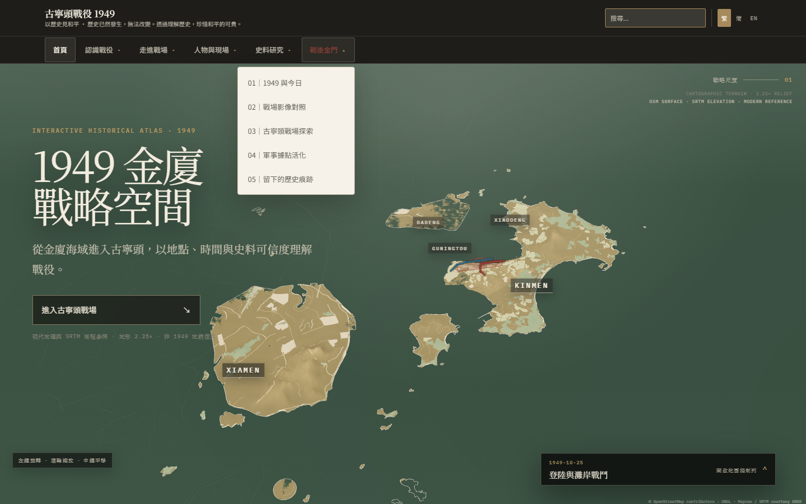
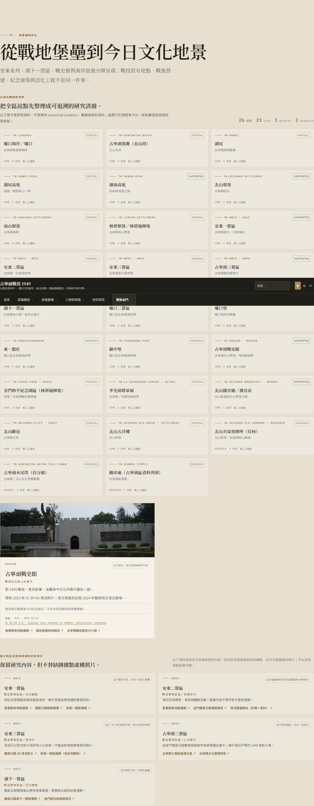

# Current visual snapshot

- Commit: `4c3ffe9`
- Branch: `fix/site-content-quality-v4`
- Preview URL: not configured
- Captured: 2026-10-19T05:12:08.390Z

[Commit-bound acceptance report](./ACCEPTANCE_REPORT.md)

These are selected review images only. The complete per-run set remains in the GitHub Actions artifact.
