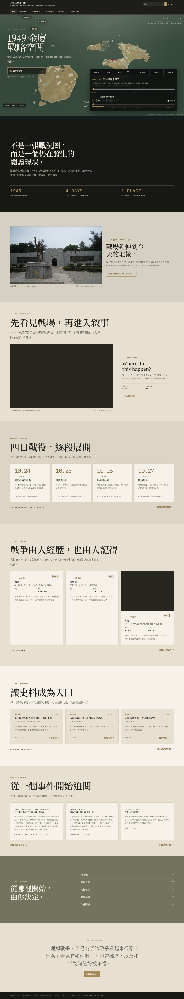
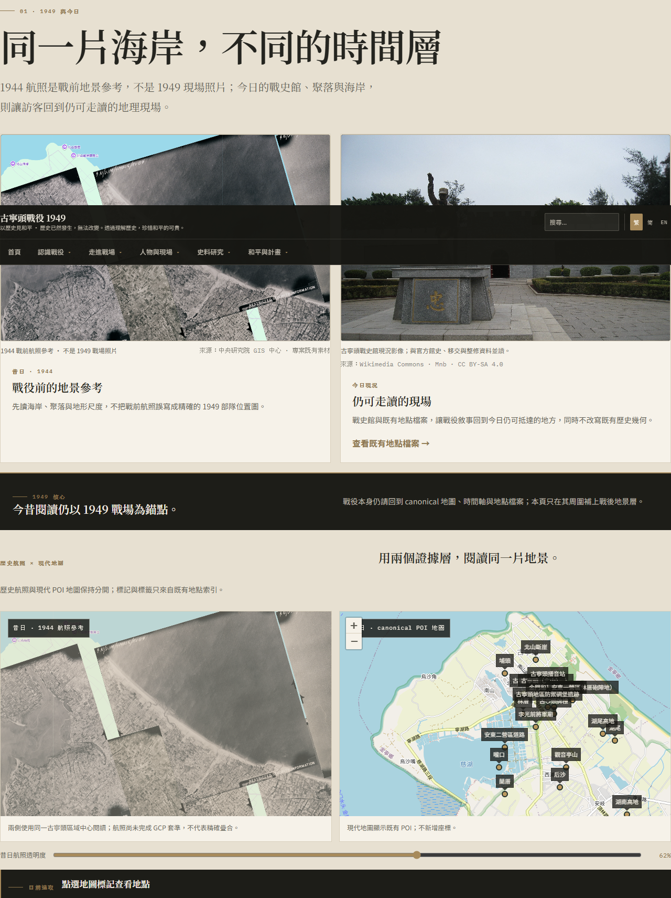
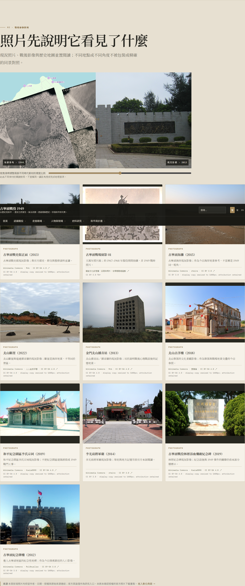
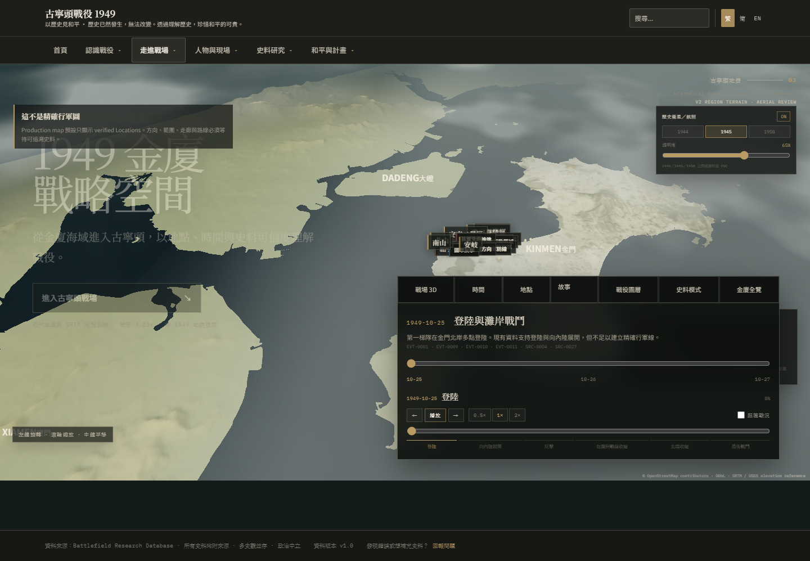
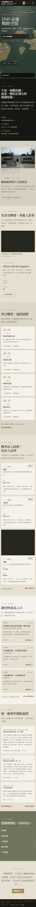
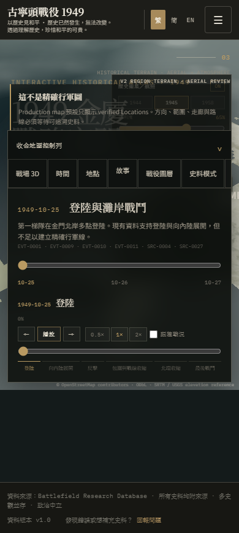
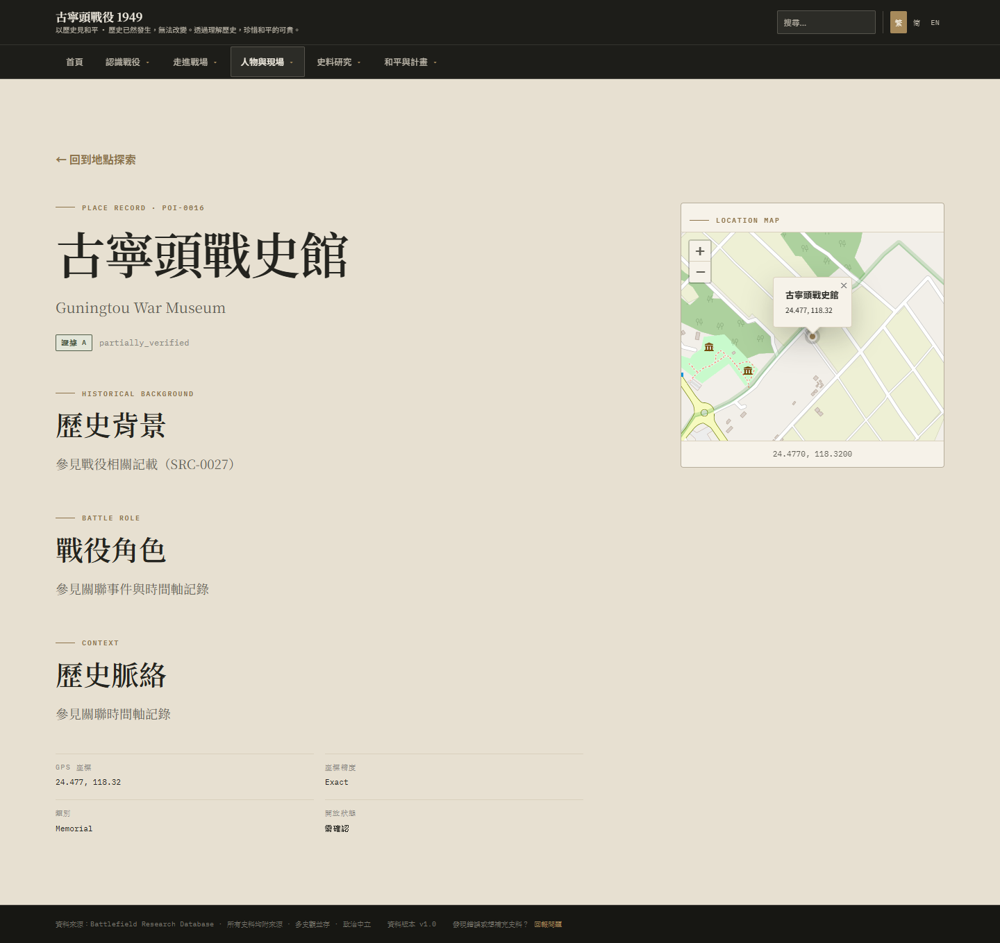

# Current visual snapshot

- Commit: `9dbf285a3c956b52e03f7f601966d11e3020203e`
- Branch: `feature/guningtou-then-now-v2`
- Preview URL: not configured
- Captured: 2026-10-19T01:42:06.846Z

[Commit-bound acceptance report](./ACCEPTANCE_REPORT.md)

These are selected review images only. The complete per-run set remains in the GitHub Actions artifact.
